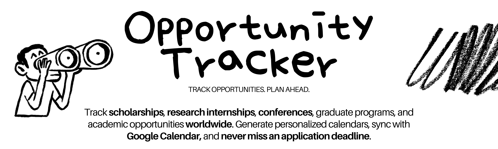

<p align="center">
  
</p>

<p align="center">
  <strong>Oportunidades organizadas. Prazos no seu calendário. Uma comunidade para manter tudo vivo.</strong>
</p>

<p align="center">
  <a href="https://lumiis2.github.io/opportunity-tracker/">Acessar calendários</a>
  ·
  <a href="https://github.com/lumiis2/opportunity-tracker/issues">Sugerir ou corrigir</a>
  ·
  <a href="#como-contribuir">Contribuir</a>
</p>

---

## O que é o Opportunity Tracker?

Oportunidades acadêmicas e profissionais incríveis existem aos milhares, mas
ficam espalhadas pela internet — e muita gente só as encontra depois que o
prazo terminou.

O **Opportunity Tracker** reúne oportunidades de graduação, mestrado,
conferências e indústria em calendários simples de acompanhar. A proposta é
direta: escolha uma categoria, adicione o link ao seu aplicativo de calendário
e tenha os prazos disponíveis no lugar onde você já organiza sua rotina.

Este é ao mesmo tempo um serviço público e uma base open source. Você pode:

- usar os calendários já publicados;
- fazer um fork e publicar calendários para sua área ou comunidade;
- contribuir com dados, documentação, testes, parsers ou melhorias no frontend.

## Comece por aqui

👉 **[Acesse a página do Opportunity Tracker](https://lumiis2.github.io/opportunity-tracker/)**

Ela apresenta contagens atualizadas, próximas oportunidades, links públicos de
assinatura, downloads `.ics` e os CSVs de origem. Os cards são gerados a partir
dos mesmos dados normalizados utilizados para construir os calendários.

## Calendários disponíveis

Copie a URL do calendário e cole na opção **Do URL** ou **Por URL** do seu aplicativo de calendário.

> Clicar em um link `.ics` pode baixar o arquivo. Para criar uma assinatura
> recorrente, copie a URL exibida no site e use a opção **Por URL** do seu
> aplicativo de calendário.

| Categoria | URL do calendário — copie e cole | Baixar `.ics` | Baixar CSV |
| --- | --- | --- | --- |
| 🎓 Graduação | `https://lumiis2.github.io/opportunity-tracker/graduation.ics` | [graduation.ics](https://lumiis2.github.io/opportunity-tracker/graduation.ics) | [graduation.csv](https://lumiis2.github.io/opportunity-tracker/data/graduation.csv) |
| 🏫 Mestrado | `https://lumiis2.github.io/opportunity-tracker/masters.ics` | [masters.ics](https://lumiis2.github.io/opportunity-tracker/masters.ics) | [masters.csv](https://lumiis2.github.io/opportunity-tracker/data/masters.csv) |
| 💼 Indústria | `https://lumiis2.github.io/opportunity-tracker/industry.ics` | [industry.ics](https://lumiis2.github.io/opportunity-tracker/industry.ics) | [industry.csv](https://lumiis2.github.io/opportunity-tracker/data/industry.csv) |
| 📚 Conferências | `https://lumiis2.github.io/opportunity-tracker/conferences.ics` | [conferences.ics](https://lumiis2.github.io/opportunity-tracker/conferences.ics) | [conferences.csv](https://lumiis2.github.io/opportunity-tracker/data/conferences.csv) |
| 🤖 Pesquisa e bolsas em IA/ML | `https://lumiis2.github.io/opportunity-tracker/ai_ml_research_fellowships.ics` | [ai_ml_research_fellowships.ics](https://lumiis2.github.io/opportunity-tracker/ai_ml_research_fellowships.ics) | [ai_ml_research_fellowships.csv](https://lumiis2.github.io/opportunity-tracker/data/ai_ml_research_fellowships.csv) |
| 🗂️ Calendário pessoal | `https://lumiis2.github.io/opportunity-tracker/personal.ics` | [personal.ics](https://lumiis2.github.io/opportunity-tracker/personal.ics) | [personal.csv](https://lumiis2.github.io/opportunity-tracker/data/personal.csv) |
| 🌐 Todas as oportunidades | `https://lumiis2.github.io/opportunity-tracker/all.ics` | [all.ics](https://lumiis2.github.io/opportunity-tracker/all.ics) | — |

## Como usar

### 1. Assinar pelo link — recomendado

Copie o endereço do arquivo `.ics` da categoria desejada e adicione-o pela
opção **Por URL** do seu aplicativo de calendário.

Ao assinar, o aplicativo consulta o mesmo endereço periodicamente. Assim, as
atualizações publicadas no calendário podem aparecer para quem já utiliza o
link, sem a necessidade de baixar um novo arquivo manualmente.

### 2. Baixar o arquivo `.ics`

Abra um dos links `.ics` da tabela e salve o arquivo para importá-lo no Google
Calendar, Apple Calendar, Outlook ou outro aplicativo compatível.

> **Atenção:** importar um arquivo baixado cria uma cópia pontual. Para receber
> atualizações futuras, prefira a assinatura por URL.

### 3. Baixar os dados em CSV

Use a coluna **Baixar CSV** para consultar, filtrar ou editar os dados de uma
categoria. Esses arquivos também servem como modelo para criar um calendário
personalizado.

### 4. Gerar um calendário personalizado localmente

Clone o repositório e instale as dependências:

```bash
git clone https://github.com/lumiis2/opportunity-tracker.git
cd opportunity-tracker
python -m venv .venv
source .venv/bin/activate
pip install -r requirements.txt
```

Copie ou baixe um CSV oficial, remova ou edite as linhas que desejar e execute:

```bash
python -m src.cli generate-ics \
  --track graduation \
  --input opportunities.csv \
  --output my_calendar.ics
```

Valores aceitos em `--track`: `graduation`, `masters`, `industry`,
`conferences`, `ai_ml_research_fellowships` e `personal`.

Para montar sua própria planilha pessoal e, opcionalmente, publicar uma URL
atualizável, consulte o [tutorial de calendário pessoal](tutorials-and-info/COMO-CRIAR-SEU-CALENDARIO.md).

Depois que as dependências estiverem instaladas, a geração funciona localmente
e não depende de Google Sheets, credenciais ou GitHub Pages. O CSV precisa manter as mesmas colunas
do arquivo oficial da categoria escolhida. Para utilizar outro formato de
colunas, será necessário implementar um novo parser.

## Como o projeto funciona

```text
Google Sheets
    ↓ scripts/sync_sheets.py
Arquivos CSV em data/
    ↓ parsers de cada categoria
Modelos Opportunity + Milestone
    ↓ validação e build
Calendários ICS + opportunities.json + calendars.json
    ↓ GitHub Actions
Frontend estático no GitHub Pages
```

O projeto mantém uma stack pequena de propósito:

- **Python** sincroniza os CSVs, normaliza oportunidades, valida os dados e gera ICS/JSON.
- **HTML, CSS e JavaScript** renderizam o frontend estático sem framework.
- **GitHub Actions** executa testes, gera os artefatos e publica o GitHub Pages toda segunda-feira ou manualmente.
- **GitHub Pages** é a origem canônica das URLs públicas de assinatura.

Os JSONs normalizados também funcionam como um contrato público simples:

- [`calendars.json`](https://lumiis2.github.io/opportunity-tracker/calendars.json) descreve os calendários e suas contagens.
- [`opportunities.json`](https://lumiis2.github.io/opportunity-tracker/opportunities.json) contém oportunidades e milestones normalizadas.

## Executar o projeto completo localmente

Instale as dependências de desenvolvimento e gere os dados atuais:

```bash
python -m venv .venv
source .venv/bin/activate
pip install -r requirements-dev.txt
pytest -q
python scripts/build.py
```

Para visualizar o site:

```bash
mkdir -p public/data
cp output/*.ics output/*.json public/
cp data/*.csv public/data/
python -m http.server 8000 --directory public
```

Abra `http://localhost:8000`. Os botões de assinatura continuarão apontando
para os calendários canônicos do GitHub Pages.

## Criar seu próprio fork

O repositório pode servir como base para um calendário pessoal, acadêmico ou comunitário:

1. Faça um fork e clone o repositório.
2. Troque no `config.yaml` o ID da planilha pública e os GIDs das abas.
3. Mantenha um schema CSV existente ou adicione um parser pequeno para suas colunas.
4. Atualize os nomes e as descrições dos calendários.
5. Troque `CALENDAR_BASE_URL` em `public/app.js` pelo host permanente dos seus calendários.
6. Ative o GitHub Pages via GitHub Actions nas configurações do fork.
7. Execute o workflow manualmente e confira os arquivos `.ics` e JSON gerados.

Para a configuração pessoal mais simples, siga o [tutorial de calendário pessoal](tutorials-and-info/COMO-CRIAR-SEU-CALENDARIO.md). Nunca versione credenciais privadas: a sincronização atual precisa apenas de planilhas com leitura pública.

## Adicionar ao Google Calendar por URL

Faça a primeira assinatura pelo Google Calendar no navegador de um computador:

1. Copie o link `.ics` da categoria desejada.
2. Abra o [Google Calendar](https://calendar.google.com/).
3. Ao lado de **Outros calendários**, clique no botão **+**.
4. Escolha **Do URL** ou **From URL**, dependendo do idioma da sua conta.
5. Cole o link e clique em **Adicionar calendário**.
6. O novo calendário aparecerá em **Outros calendários**.

O Google Calendar controla a frequência de atualização de calendários externos.
Um calendário recém-adicionado ou uma alteração recente pode levar alguns
minutos — e, em alguns casos, algumas horas — para aparecer.

## Como contribuir

Este projeto não pretende ser o calendário de uma única pessoa. Quanto mais
gente compartilhar conhecimento, mais estudantes conseguirão descobrir e
preparar-se para boas oportunidades.

Você pode contribuir:

- adicionando novas oportunidades;
- corrigindo datas ou informações desatualizadas;
- melhorando descrições e links;
- sugerindo novas categorias;
- escrevendo guias e tutoriais;
- corrigindo bugs ou melhorando o código;
- criando um fork para calendários de uma área ou comunidade específica.

Para uma alteração direta, faça um fork, crie uma branch e abra um
[Pull Request](https://github.com/lumiis2/opportunity-tracker/pulls). Para uma
sugestão, dúvida ou correção pontual, abra uma
[Issue](https://github.com/lumiis2/opportunity-tracker/issues).

Ao editar um CSV, preserve seus cabeçalhos e o formato das colunas para que o
calendário continue sendo gerado corretamente.

Antes de abrir um pull request, execute:

```bash
pytest -q
python scripts/build.py
```

Prefira mudanças pequenas e mensagens descritivas. Atualizações de CSV, ICS e
JSON devem permanecer consistentes com os dados de origem e o resultado do build.

## Visão futura

Os calendários são apenas a primeira etapa. A visão de longo prazo é construir
uma base colaborativa de conhecimento sobre oportunidades acadêmicas e
profissionais.

No futuro, cada oportunidade poderá ter conteúdo explicando o programa, quem
pode participar, como funciona a seleção, documentos comuns, cronogramas,
experiências de participantes, dicas de preparação e links úteis. A ideia
também inclui espaço para programas recorrentes ou ainda sem uma data definida.


<p align="center">
  <strong>Encontrou uma oportunidade? Compartilhe. Viu algo errado? Corrija.<br>
  Este projeto fica melhor sempre que alguém decide ajudar.</strong>
</p>

## Licença

Distribuído sob a [licença MIT](LICENSE).
